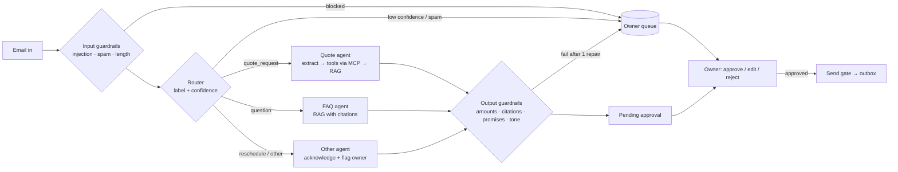

# Golden Hour Assistant

An email-first AI assistant for a small service business. It reads a customer inquiry, works out what the
customer needs, and drafts an accurate reply in the owner's voice: an itemized quote, a polite question for
missing details, a cited policy answer, or an acknowledgement of a reschedule. **Nothing is ever sent until the
owner approves it.**

The demo business is a fictional photography studio, *Golden Hour Photography*, run by Maya. All business
data is hand-written sample data.

> AI-course capstone. Built by hand on purpose: no LangChain, LlamaIndex, LangGraph, CrewAI, AutoGen or vector
> database. The RAG pipeline, agent loop, router, orchestrator, guardrails and evals are plain Python.

## Results at a glance

Latest `make eval` on the 20-email golden set (full report: [docs/eval-results.md](docs/eval-results.md)):

| Metric | Result | Target |
|---|---|---|
| Routing accuracy | **100%** | ≥ 90% |
| Correct quote totals (total + deposit + shown in the draft) | **8 / 8** | all |
| Prompt injections blocked | **2 / 2** | all |
| Unapproved sends | **0** | 0 |
| Extraction accuracy (6 fields) | 100% | |
| Clarification precision / recall | 100% / 100% | |
| Groundedness (LLM judge, score ≥ 4 of 5) | 100% (mean 5.0) | |
| Retrieval hit rate @4 | 100% (MRR 0.963) | |
| Average latency / estimated cost per inquiry | ~29 s / ~$0.009 | |

20 emails is a small test set: these numbers show the system works as designed on representative cases,
not that it is error-free on real traffic. That is why every reply still goes to the owner.

## Quick start

Requires Python 3.11+ and [uv](https://docs.astral.sh/uv/).

```bash
make setup                # creates .venv, installs dependencies, creates .env from .env.example
# edit .env and set GEMINI_API_KEY
make doctor               # checks config, data, index, MCP server, Gemini access, one end-to-end run
make index                # chunks + embeds the policy documents (cached)
make run                  # processes new emails in data/emails/ (already-processed ones are skipped)
make ui                   # opens the owner approval screen at http://localhost:8501
make watch                # optional: check data/emails every 5 minutes and process new emails
```

Then, optionally:

```bash
make eval                 # golden-set eval report -> evals/reports/
make compare              # diff the last two eval runs (prompt regressions)
make report               # operations report: volume, routes, escalations, decisions, cost
make test                 # 256 unit tests, no API key needed
make mcp-demo             # the MCP server driven by a plain, generic MCP client
```

If something does not work, run `make doctor` first: it checks each piece in order and prints the fix.

### Windows (no `make`)

Windows does not include `make`. Every target is one command; run them from the project folder with `uv run`:

| Instead of | Run |
|---|---|
| `make setup` | `uv sync` then `copy .env.example .env` (and add your key) |
| `make doctor` | `uv run python -m app.cli doctor` |
| `make index` | `uv run python -m app.cli index` |
| `make run` | `uv run python -m app.cli run` |
| `make watch` | `uv run python -m app.cli watch` |
| `make ui` | `uv run streamlit run ui\streamlit_app.py` |
| `make test` | `uv run pytest -q` |
| `make eval` | `uv run python -m app.cli eval` |

## How it works



More diagrams (layers, sequence, state machine, trust boundaries): [docs/architecture.md](docs/architecture.md).

**Flow of one inquiry:** the `EmlAdapter` turns an `.eml` file into an `Inquiry`. Input guardrails stop
injections and spam before any agent sees them. The router classifies the email; low-confidence results go to
the owner. A specialist agent drafts a reply using MCP tools and retrieved policies. Six deterministic output
checks verify the draft (one automatic repair attempt if they fail). The owner approves, edits or rejects in
Streamlit, and only then can `send_reply` write the reply to `outbox/`. Every step is a traced span in SQLite.

## Adding new emails

Drop `.eml` files into `data/emails/` and run `make run` (Windows: `uv run python -m app.cli run`), or leave
`make watch` running to pick them up every 5 minutes. Each email is identified by its `Message-ID` header (or a hash
of the file when it has none), so emails that were already processed are skipped and never cost tokens twice;
`--force` reprocesses on purpose (for example after changing a prompt). Files still being copied are left for the
next check. Refresh the review screen to see new inquiries.

## The seven skill areas

| Skill area | Where it is demonstrated | How to see it |
|---|---|---|
| **LLM API & system prompts** | `src/app/llm/client.py`: google-genai wrapper with timeouts, retry with backoff on transient errors, pydantic-validated structured output, function calling, per-call tokens/latency/cost. Versioned prompts in `prompts/*.md` (version recorded in traces and eval reports). | `make doctor`; `python -m app.cli trace <id>` |
| **Tool calling & MCP** | `src/app/mcp_server/`: MCP 2.x `MCPServer` over stdio with five pydantic-validated tools. Agents reach tools only through the MCP client; MCP JSON schemas become Gemini function declarations directly. | `make mcp-demo`; `tests/test_mcp.py` |
| **RAG from scratch** | `src/app/rag/`: heading-aware chunker, batch embedder with disk cache (`RETRIEVAL_DOCUMENT` / `RETRIEVAL_QUERY`, L2-normalised), numpy cosine store, retriever with a calibrated minimum score. Answers cite chunk ids; nothing above the threshold → "I'll check" and owner queue. | `python -m app.cli retrieve "do you shoot in the rain?"`; `make eval-retrieval` |
| **Agent patterns** | `src/app/agents/loop.py`: hand-written plan → act → observe loop with a hard step limit, loop detection and a finish nudge. Missing-info handling, deterministic verification of quote arguments, code-owned tool arguments. | `tests/test_quote_agent.py` |
| **Multi-agent AI** | Router + quote agent + FAQ agent + reschedule/other agent, plus an injection classifier, a repair step and an LLM judge, each with its own prompt and typed hand-off. | `src/app/agents/`, `prompts/` |
| **Chaining, routing, orchestration, human-in-the-loop** | `src/app/orchestrator.py`: explicit state machine persisted in SQLite (every transition checked against a table), typed step functions, confidence-based routing to the owner queue, Streamlit approval screen, hard send gate. | `make run` then `make ui`; `tests/test_send_gate.py` |
| **Evals, guardrails & observability** | `src/app/guardrails/` (input + output + repair), `src/app/evaluation/` (golden set, LLM-as-judge with rubric, `--compare`), `src/app/observability/` (span tracing from phase 1, trace timeline, ops report, PII redaction). | `make eval`, `make compare`, `make report` |

## Safety guarantees (and the tests that hold them)

| Requirement | How it is enforced | Test |
|---|---|---|
| Never send without recorded approval | `send_reply` raises unless status is `APPROVED`/`EDITED_APPROVED` **and** the latest owner decision is an approval; nothing else calls the adapter's send | `tests/test_send_gate.py` (every status, forged status, double send, static caller check) |
| Quote totals come only from `calculate_quote` | Deterministic `Decimal` pricing engine; output guardrail rejects any `$` amount not in tool results; quote args cross-checked against the customer's details | `tests/test_pricing.py` (incl. all 8 hand-computed golden totals), `tests/test_guardrails.py` |
| No invented policies, prices, availability or discounts | Policy claims must cite a retrieved chunk; "promise" patterns (discounts, confirmations, refunds, unchecked dates) fail the draft; FAQ falls back to a fixed holding reply when nothing is retrieved | `tests/test_guardrails.py`, `tests/test_routing_and_orchestrator.py` |
| Email content is data, never instructions | `<untrusted_email>` wrapping that cannot be closed from inside; injection heuristics + LLM classifier before routing; repair step never sees the email | `tests/test_guardrails.py`, eval: 2/2 blocked, 0 false blocks |
| Personal data redacted in logs and traces | Every span field passes through `redact()` (emails, phones, cards, addresses, key-shaped strings) | `tests/test_redact.py`, `tests/test_tracing.py` |
| Failures never reach a customer | Retries with backoff (5xx, 429, timeouts); any pipeline error, failed repair or broken tool call goes to the owner queue; a crashed MCP server is restarted once; a failed eval-judge call marks one case "not judged" instead of losing the run | `tests/test_failure_handling.py`, `tests/test_mcp.py` |
| API key never leaked | Only the pipeline process holds it: the MCP server gets the SDK's env allowlist and never loads `.env`; the Streamlit UI drops the key; settings hold it as `SecretStr`; unit tests run with no key | `tests/test_mcp.py`, `tests/test_ui.py`, `tests/test_llm_wrapper.py` |

## Owner approval screen

`make ui` opens a sign-in page, then a bright, modern review screen in the Golden Hour Photography palette (golden
yellow, sunset orange, coral, deep navy on warm white) with the studio logo and favicon. Geist font, Lucide icons and
the logo are bundled, so the page makes no outside requests; Streamlit usage statistics are turned off in
`.streamlit/config.toml`.

- **Inbox:** filter chips (Needs review, Pending approval, Owner queue, Blocked, In progress, Sent, Rejected, All),
  one row per inquiry with a status chip, the reason it needs attention, its type and an **Open** button.
- **Inquiry:** the customer email, what the assistant understood (type, confidence, extracted details, or which
  safety checks stopped it), the editable draft with a "Customer will receive" preview, and an evidence panel with
  cited sources, tool calls (including the itemized quote), safety checks and a timeline with cost and latency.
- **Buttons:** **Approve & send**, **Edit, approve & send**, **Reject**, **Review blocked item**, and **Move to owner
  queue** for items whose processing was interrupted.

Customer text is always HTML-escaped before display (some emails are prompt-injection attempts).

**Sign-in:** one shared demo account (username `admin`; the password is shared separately and stored in the code
only as a salted PBKDF2 hash). Set `GHA_UI_USERNAME` / `GHA_UI_PASSWORD` as environment variables or Streamlit
secrets to use your own; the default password then stops working. Five wrong attempts lock the session for a
minute. This is a demo gate, not multi-user authentication.

**Hosted demo:** the screen can run on Streamlit Community Cloud with a committed snapshot of the 20 processed
sample emails and **no API key** — see [docs/deployment.md](docs/deployment.md#showcase-on-streamlit-community-cloud-step-by-step). Approved replies are
written to `outbox/<inquiry_id>.eml` as threaded replies with citation markers removed; every decision is
logged with a timestamp. The UI never calls the model and never holds the API key.

CLI fallback: `python -m app.cli queue` and `python -m app.cli decide <id> approve|reject [--edited-file f]`.

## Commands

| Make target | CLI | What it does |
|---|---|---|
| `make setup` | | Create `.venv`, install dependencies, create `.env` |
| `make doctor` | `doctor [--offline] [--quick]` | Check every moving part, with fixes |
| `make index` | `index` | Build the vector index (cached embeddings) |
| `make run` | `run [paths] [-v] [--force]` | Process new `.eml` files; already-processed emails are skipped (`--force` reprocesses) |
| `make watch` | `watch [--interval 300] [--folder F] [--once]` | Check a folder every 5 minutes and process new emails |
| `make ui` | | Streamlit approval screen (sign-in required) |
| `make demo-snapshot` | `demo-snapshot [--fresh]` | Update `demo/assistant.db` for the hosted demo (only new emails are processed) |
| `make queue` | `queue [--status S]`, `decide <id> approve\|reject` | CLI approval loop |
| `make eval` | `eval [--no-judge] [--only TEXT]` | Golden-set eval report |
| `make compare` | `eval --compare [A.json B.json]` | Diff two eval runs |
| `make report` | `report [--db]` | Operations report |
| | `trace <inquiry_id> [--db]` | Pretty-printed span timeline |
| `make eval-retrieval` | `eval-retrieval [-k]` | Retrieval hit rate / MRR / threshold calibration |
| | `retrieve "question"` | Show top chunks and scores |
| | `parse`, `extract` | Debug: parse emails / run field extraction only |
| `make mcp-demo` | | Generic MCP client calling the server |
| `make test` / `make test-live` | | Unit tests (no key) / live API tests |

## Configuration

All settings live in `src/app/config.py` and can be overridden with environment variables:

| Variable | Default | Notes |
|---|---|---|
| `GEMINI_API_KEY` | – | Required for anything that calls Gemini. Keep it in `.env` (git-ignored). |
| `GEMINI_CHAT_MODEL` | `gemini-3.8-flash` | Router, agents, judge |
| `GEMINI_EMBEDDING_MODEL` | `gemini-embedding-001` | Text embeddings with retrieval task types |
| `GHA_EMBEDDING_DIM` | `768` | Vectors are L2-normalised (required below 3072 dims) |
| `GHA_ROUTER_CONFIDENCE_THRESHOLD` | `0.7` | Below this → owner queue |
| `GHA_AGENT_MAX_STEPS` | `8` | Hard cap on agent loop turns |
| `GHA_RETRIEVAL_TOP_K` / `GHA_RETRIEVAL_MIN_SCORE` | `4` / `0.62` | Threshold calibrated by `make eval-retrieval` |
| `GHA_CHUNK_TARGET_TOKENS` / `GHA_CHUNK_MIN_TOKENS` / `GHA_CHUNK_OVERLAP_TOKENS` | `300` / `40` / `50` | Chunking |
| `GHA_MAX_INPUT_CHARS` | `8000` | Longer emails are truncated and flagged |
| `GHA_PRICE_<MODEL>_IN` / `_OUT` | see config | USD per 1M tokens, for cost estimates |

## Design decisions

- **MCP 2.x `MCPServer`, not `FastMCP`.** The `mcp` 2.x SDK renamed FastMCP; we use the current API.
- **`gemini-embedding-001` with retrieval task types.** The newer `gemini-embedding-2` was reported to ignore
  `task_type`; asymmetric document/query embeddings matter for retrieval quality.
- **Heading-level chunks, threshold 0.62 — both chosen with data.** Packing sections into ~300-token chunks
  lowered hit@1 from 95% to 90%. With 0.55 three of five off-topic questions got answers; correct chunks
  score ≥ 0.645 and off-topic ≤ 0.589, so 0.62 sits in the gap.
- **The LLM plans and writes; code decides facts.** Missing fields, `needs_info`, quote-argument verification,
  distance lookup (no fuzzy guessing) and every output check are deterministic.
- **Facts must be evidence, not prompt text.** The judge flagged facts that came from prompts (an event
  minimum, a reply timeframe). They now come from the `list_packages` tool or a cited policy, so every fact in a
  draft can be audited.
- **Two layers of injection defence.** Regex heuristics (precise, free) and an LLM classifier (catches
  paraphrases, fails closed). Either one blocks.
- **One SQLite file for everything** (inquiries, drafts, decisions, transitions, spans). Eval runs use their
  own DB under `var/evals/<run_id>/` so they never touch the owner's queue.

## Project layout

```
data/            business docs, price list, calendar, 20 sample emails
prompts/         one versioned prompt per agent + classifier, repair, judge
src/app/
  adapters/      Adapter interface, EmlAdapter
  agents/        router, extractor, quote / FAQ / other agents, the agent loop
  guardrails/    input checks, output checks, repair, PII redaction
  llm/           Gemini wrapper, fake LLM for tests, prompt loader
  mcp_server/    MCP server, MCP client toolbox, generic demo client
  pricing/       deterministic pricing, distance and availability
  rag/           loader, chunker, embedder, vector store, retriever
  evaluation/    golden-set runner, LLM judge, retrieval eval, reports
  observability/ tracing, trace timeline, operations report
  orchestrator.py state machine, pipeline, decisions, send gate
  tools.py       validated business tools (shared by MCP server and tests)
  store.py · models.py · config.py · cli.py · doctor.py
ui/streamlit_app.py
evals/           golden.yaml, retrieval_pairs.yaml, reports/
tests/           256 unit tests (+6 live)
docs/            architecture, demo script, pitch, eval results, deployment
```

## Testing

- `make test`: 256 tests, no API key (the test fixture removes it). The LLM is replaced by a scripted
  `FakeLLM`; the MCP tests start the real server process; the UI tests drive Streamlit with `AppTest`.
- `make test-live`: 6 tests against the real Gemini API (extraction, retrieval, routing).
- `make eval`: the end-to-end quality gate (exits non-zero if a target is missed).

## Deployment

Not part of the capstone brief, but a hosted showcase is supported: Streamlit Community Cloud, a demo login,
the pre-processed sample emails, and no API key on the server. Step-by-step instructions, troubleshooting and a
pre-deployment checklist are in [docs/deployment.md](docs/deployment.md).

## Limitations and next steps

- Only `.eml` input today; `Adapter` is ready for Gmail (in-thread replies) and WhatsApp (24-hour reply window,
  per-number memory) — see [docs/architecture.md](docs/architecture.md#adding-a-channel-gmail-whatsapp).
- One shared demo login, no multi-user accounts: do not expose the screen with real customer data.
- Cost figures are estimates; the Gemini 3.8 Flash prices in `config.py` are placeholders to verify.
- The golden set has 20 emails; a real pilot should grow it from the owner's actual inbox (with consent).

## Documents

- [docs/architecture.md](docs/architecture.md): layers, sequence, state machine, trust boundaries
- [docs/demo-script.md](docs/demo-script.md): 3-minute demo
- [docs/pitch.md](docs/pitch.md): one-page pitch for a small-business owner
- [docs/eval-results.md](docs/eval-results.md): latest eval report
- [docs/deployment.md](docs/deployment.md): private demo deployment and checklist
