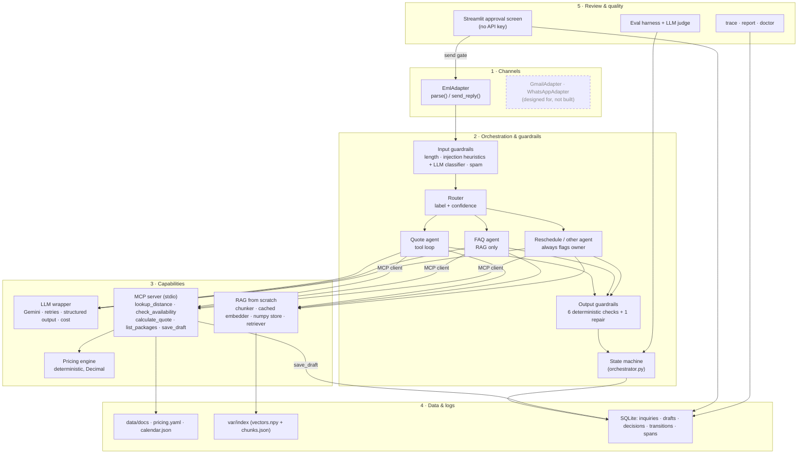
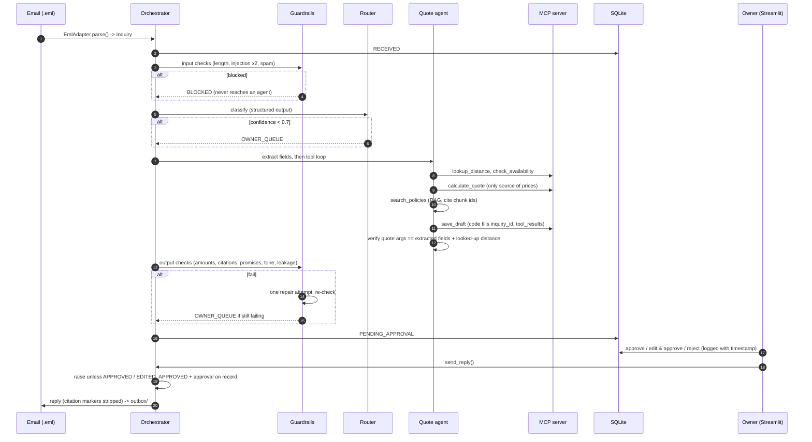
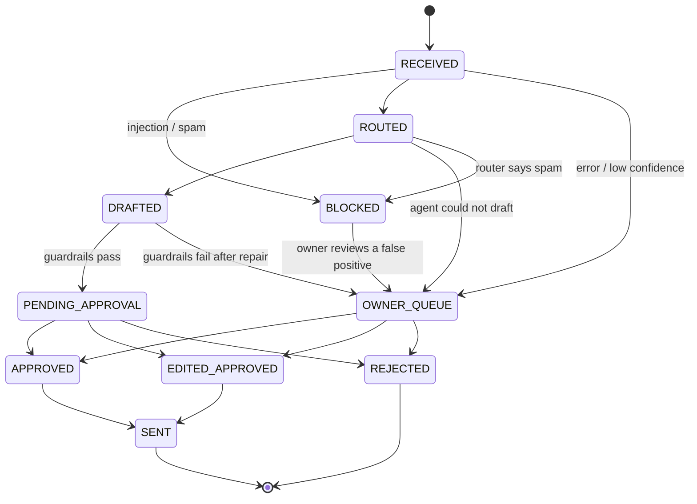

# Architecture

Golden Hour Assistant is split into five layers. A layer only talks to the one below it through a typed
interface, so a new channel (Gmail, WhatsApp) or a new tool can be added without touching the agents.

## Layers

## One inquiry, end to end

## State machine

Every status change goes through `orchestrator.transition()`, which rejects anything not in this table.

## Trust boundaries

| Boundary | Rule | Where |
|---|---|---|
| Email text → any prompt | Always wrapped in `<untrusted_email>`; a closing tag inside the email is neutralised | `agents/common.py` |
| Email → agents | Input guardrails run first; blocked mail never reaches an agent | `guardrails/input.py` |
| Model → facts | Prices, distances, availability, packages come only from MCP tools; policies only from retrieval | `prompts/*`, `agents/quote_agent.py` |
| Model → stored draft | `inquiry_id`, `tool_results`, `needs_info` are code-owned and hidden from the model | `agents/loop.py` |
| Model → quote | `calculate_quote` args are cross-checked against extracted fields and the looked-up distance | `verify_quote_calls` |
| Draft → owner | Six deterministic output checks, one repair, then the owner queue | `guardrails/output.py` |
| Owner → customer | `send_reply` raises unless approved and an approval decision is on record | `orchestrator.py` |
| API key | Only the pipeline process holds it. The MCP server gets an env allowlist; the UI drops the key | `mcp_server/client.py`, `ui/streamlit_app.py` |

## Adding a channel (Gmail, WhatsApp)

1. Implement `Adapter.parse()` to build an `Inquiry` (WhatsApp: set `reply_window_expires_at` = last
   customer message + 24 h and use the phone number as `thread_id` for conversation memory).
2. Implement `Adapter.send_reply()` (Gmail: reply in-thread with `In-Reply-To`; WhatsApp: refuse after the
   window closes and keep messages short).
3. Nothing else changes: agents, guardrails, the state machine and the send gate are channel-agnostic.
